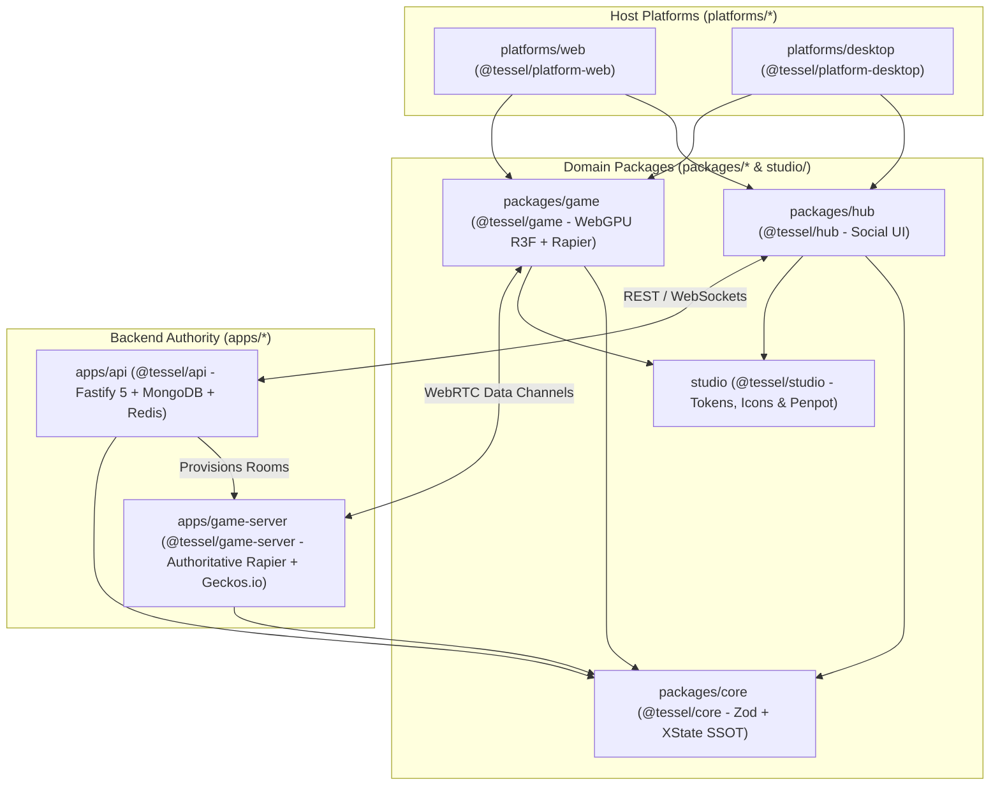

# Tessel Hybrid Spatial Social Ecosystem (`@tessel/root`)

Next-generation hybrid spatial social ecosystem and multiplayer 3D simulation monorepo (`tupynambalucas-dev/tessel`) bridging asynchronous social networking with synchronous WebGPU/Three.js 3D instances, deterministic Rapier physics, and distributed Fastify 5 + Geckos.io backend authority.

---

## 1. Architecture Overview

`tessel` operates on a dual-layer **Hub & Instance** architecture governed by a **Single Source of Truth (`@tessel/core`)**:

1. **The Social Hub (`packages/hub`, `platforms/web`, `platforms/desktop`)**: Asynchronous social network layer providing unified identity (SSO), community timelines, social feeds, and cross-platform host shells (Vite Web and Electron Desktop).
2. **The Spatial Instance (`packages/game`, `apps/game-server`)**: Synchronous 3D multiplayer simulation powered by Three.js WebGPU / Three Shading Language (TSL), React Three Fiber v9, XState character machines, Rapier 3D deterministic WASM physics, and Geckos.io WebRTC UDP data channels.
3. **The Authority (`apps/api`)**: Stateless Fastify v5 backend orchestrating authentication, MongoDB/Mongoose persistence, Redis/BullMQ workers, matchmaking, and Dedicated Game Server (DGS) room provisioning.



```text
tessel/
├── .agents/                 # Agent Mesh plugin bindings (plugins.json)
├── apps/
│   ├── api/                 # @tessel/api (Fastify 5 backend authority, MongoDB, Redis/BullMQ)
│   └── game-server/         # @tessel/game-server (Dedicated Game Server with Rapier WASM & Geckos.io)
├── packages/
│   ├── core/                # @tessel/core (SSOT: Zod v4 schemas, XState machines, physics constants)
│   ├── game/                # @tessel/game (Three.js WebGPU / R3F v9 spatial engine & Rapier client)
│   └── hub/                 # @tessel/hub (Asynchronous social network UI & Zustand stores)
├── platforms/
│   ├── desktop/             # @tessel/platform-desktop (Electron 41 + electron-vite desktop shell)
│   └── web/                 # @tessel/platform-web (Vite 8 + React 19 browser shell)
├── studio/                  # @tessel/studio (Brand design tokens, React icons, Penpot & Blender pipelines)
├── tools/                   # @tessel/tools (Workspace automation & local MCP infrastructure)
├── knowledge-base/          # @tessel/knowledge-base (Docusaurus v3 internal engineering portal)
├── AGENTS.md                # Sovereign Layer-1 AI agent context router
├── CHANGELOG.md             # Release history and version changelog
├── CONTRIBUTING.md          # Developer contribution guidelines
├── LICENSE.md               # Repository license specification
├── ROADMAP.md               # Product and engineering milestone roadmap
├── package.json             # Root monorepo manifest and pipeline scripts
├── pnpm-workspace.yaml      # Strict pnpm workspace catalogs (tooling, shared, web, desktop, api, docs, studio)
└── README.md                # Primary developer documentation
```

---

## 2. Subsystems & Navigation

| Subsystem / Workspace | Package / Scope | Documentation | Agent Context | Responsibilities |
| :--- | :--- | :--- | :--- | :--- |
| **`apps/api`** | `@tessel/api` | [`apps/api/README.md`](./apps/api/README.md) | *(inherits root)* | Stateless Fastify v5 backend authority, authentication, social feeds, and room orchestration. |
| **`apps/game-server`** | `@tessel/game-server` | [`apps/game-server/README.md`](./apps/game-server/README.md) | *(inherits root)* | Stateful Dedicated Game Server (DGS) running authoritative Rapier 3D ticks and Geckos.io sync. |
| **`packages/core`** | `@tessel/core` | [`packages/core/README.md`](./packages/core/README.md) | *(inherits root)* | Single Source of Truth (SSOT) housing Zod v4 schemas, XState machines, and physics presets. |
| **`packages/game`** | `@tessel/game` | [`packages/game/README.md`](./packages/game/README.md) | *(inherits root)* | WebGPU / Three.js / React Three Fiber 3D scene orchestrator, character controllers, and Rapier physics. |
| **`packages/hub`** | `@tessel/hub` | [`packages/hub/README.md`](./packages/hub/README.md) | *(inherits root)* | Social Hub React 19 UI components, timelines, messaging, and Zustand state stores. |
| **`platforms/web`** | `@tessel/platform-web` | [`platforms/web/README.md`](./platforms/web/README.md) | *(inherits root)* | Vite 8 web host shell initializing `@tessel/hub` and `@tessel/game`. |
| **`platforms/desktop`** | `@tessel/platform-desktop` | [`platforms/desktop/README.md`](./platforms/desktop/README.md) | *(inherits root)* | Electron 41 desktop host client with native window management and auto-update support. |
| **`studio`** | `@tessel/studio` | [`studio/README.md`](./studio/README.md) | *(inherits root)* | Brand design tokens, SVG icon library, self-hosted Penpot compose stack, and Blender pipelines. |
| **`tools`** | `@tessel/tools` | [`tools/README.md`](./tools/README.md) | *(inherits root)* | Developer automation scripts and workspace verification utilities. |
| **`knowledge-base`** | `@tessel/knowledge-base` | [`knowledge-base/README.md`](./knowledge-base/README.md) | *(inherits root)* | Docusaurus v3 technical documentation portal for Tessel architecture and design guides. |

### Governance & Product Artifacts

- **Contribution Guide**: [`CONTRIBUTING.md`](./CONTRIBUTING.md)
- **Master Roadmap**: [`ROADMAP.md`](./ROADMAP.md)
- **Release Changelog**: [`CHANGELOG.md`](./CHANGELOG.md)

---

## 3. Environment & Secret Governance

Runtime secrets and service endpoints for `@tessel/api`, `@tessel/game-server`, and `@tessel/studio` are injected via **Infisical** or local `.env` files excluded from version control:

| Variable Name | Target Workspace | Purpose |
| :--- | :--- | :--- |
| `NODE_ENV` / `SERVER_PORT` | `apps/api` | Runtime mode (`development` / `production`) and HTTP listener port (default `3000`). |
| `MONGO_URI` | `apps/api` | MongoDB connection string for persistent user accounts and social graph documents. |
| `REDIS_HOST` / `REDIS_PORT` | `apps/api` | Redis endpoint for session caching and BullMQ background job queues. |
| `JWT_SECRET` / `SESSION_SECRET` | `apps/api` | Cryptographic signing keys for JWT tokens and cookie sessions. |
| `PENPOT_SECRET_KEY` / `PENPOT_DATABASE_URI` | `studio` | Self-hosted Penpot design studio credentials (`studio/penpot/`). |

---

## 4. Getting Started

### Prerequisites

- **Node.js**: `>= 22.x`
- **pnpm**: `11.1.2` (enforced via `catalogMode: strict` in [`pnpm-workspace.yaml`](./pnpm-workspace.yaml))
- **Docker Compose**: Optional, required only when running local Penpot studio containers (`pnpm penpot:up`) or local MongoDB/Redis instances.

### Installation & Local Startup

```bash
# 1. Clone the repository (or sync via org-ecosystem Mani manifest)
git clone git@github.com:tupynambalucas-dev/tessel.git
cd tessel

# 2. Install workspace dependencies from strict pnpm catalogs
pnpm install

# 3. Start the Backend API in watch mode
pnpm dev:api

# 4. Start the Web Client shell (http://localhost:5173)
pnpm dev:web

# 5. Or launch the Electron Desktop Client shell
pnpm dev:desktop
```

---

## 5. Development & Pipeline Scripts

| Command | Description |
| :--- | :--- |
| `pnpm dev:web` | Starts `@tessel/platform-web` Vite development server in watch mode. |
| `pnpm build:web` | Builds `@tessel/platform-web` production web bundle. |
| `pnpm dev:desktop` | Starts `@tessel/platform-desktop` Electron development client. |
| `pnpm build:desktop` | Compiles and packages `@tessel/platform-desktop` via `electron-vite` and `electron-builder`. |
| `pnpm dev:api` | Starts `@tessel/api` Fastify backend authority in watch mode. |
| `pnpm build:api` | Compiles `@tessel/api` TypeScript sources to `dist/`. |
| `pnpm start:api` | Runs the compiled `@tessel/api` production server. |
| `pnpm lint` | Executes `turbo lint` static analysis across all monorepo workspaces. |
| `pnpm penpot:up` | Starts the self-hosted Penpot design studio container stack (`@tessel/studio`). |
| `pnpm penpot:down` | Stops the self-hosted Penpot container stack. |
| `pnpm penpot:reset` | Recreates the Penpot container stack from scratch. |
| `pnpm penpot:update` | Pulls the latest Penpot container images and restarts services. |
| `pnpm penpot:aide:up` | Starts the Penpot AI assistant service (`aide`). |
| `pnpm penpot:aide:down` | Stops the Penpot AI assistant service (`aide`). |
| `pnpm project:clean` | Cleans `node_modules` directories interactively via `npkill`. |

---

## 6. Governance & Contributing Standards

1. **Cryptographic Commit Signing**: All Git commits and annotated tags MUST be signed using SSH (`git commit -S -m "..."`).
2. **Conventional Commits**: All commit messages MUST conform to Conventional Commits v1.0.0 (`<type>(<scope>): <description>`).
3. **Single-Branch GitHub Flow**: Short-lived branches (`feat/<slug>`, `fix/<slug>`, `docs/<slug>`, `chore/<slug>`) branch off `main` and merge via reviewed Pull Requests. See [`CONTRIBUTING.md`](./CONTRIBUTING.md) for full workflow details.
4. **Zero-Emoji Invariant**: Emojis are strictly prohibited across all source code, shaders, documentation, commit messages, and pull requests.
5. **Secret Hygiene**: Never commit `.env` files or plaintext credentials; all secrets resolve via Infisical or environment variables.
6. **AI Agent Context**: Autonomous agents operating in this repository MUST read [AGENTS.md](./AGENTS.md) before modifying files.

---

## 7. License

Proprietary & Confidential (`CC-BY-NC-4.0` / All Rights Reserved). See [`LICENSE.md`](./LICENSE.md) for full licensing terms. Copyright (c) 2026 tupynambalucas.dev.
